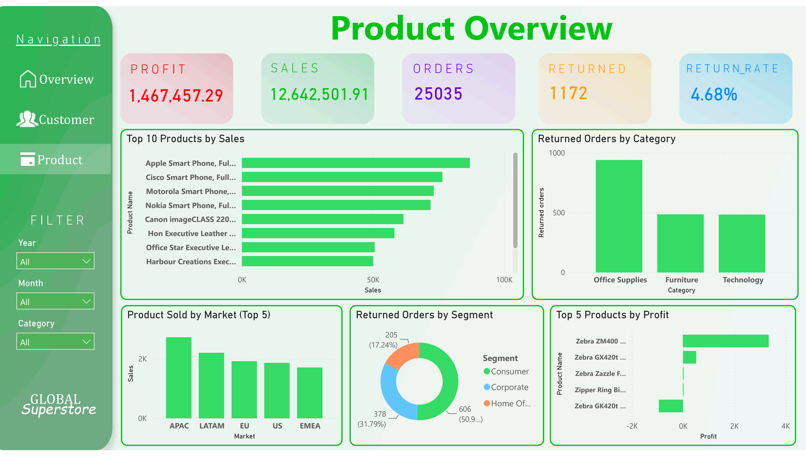
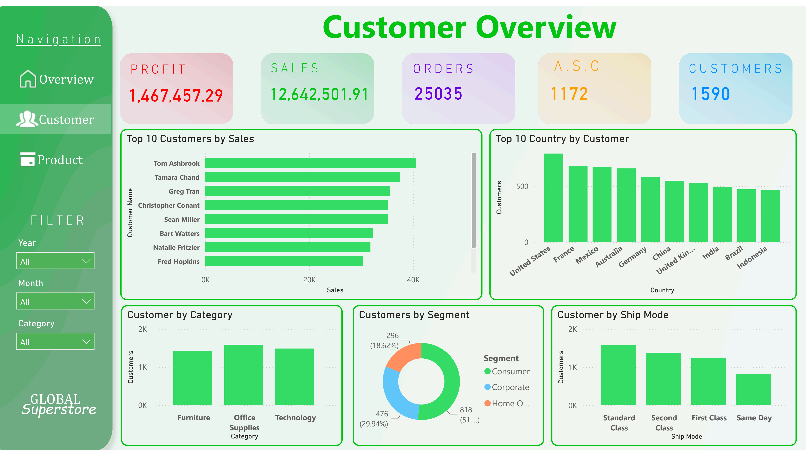

# 📊 Global Superstore Dashboard

An interactive **Power BI dashboard** created using the **Global Superstore dataset**.

The Global Superstore dataset is a widely used dataset for practicing **Power BI, data visualization, and dashboard development**. In this project, the dataset was already cleaned and prepared, so the main focus was on **data transformation, visualization, interactive filtering, and dashboard design**.

## 📈 Dashboard Highlights

- Interactive sales and performance visualizations
- Category-wise analysis
- Time-based filtering
- Interactive slicers
- Multiple dashboard pages
- Interactive page navigation
- Clear and user-friendly dashboard layout

## 🛠️ Tools & Skills Used

- **Microsoft Power BI**
- **Power Query**
- **Data Transformation**
- **Data Visualization**
- **Interactive Slicers**
- **Dashboard Design**

## 🗂️ Dataset

**Dataset:** Global Superstore

The dataset was already cleaned and prepared before being used for this project. The work in this project focused mainly on using Power BI to transform the available data into an interactive and visually understandable dashboard.

## 🎯 Project Objective

The main objective of this project was to practice creating an interactive Power BI report and improve my understanding of:

- Working with an existing dataset
- Transforming data using Power Query
- Creating meaningful visualizations
- Using slicers and filters
- Designing multiple report pages
- Creating interactive dashboard navigation
- Presenting information in a clear and simple way

## 📸 Dashboard Preview

## 💡 What I Learned

Through this project, I gained more practical experience with **Power BI and dashboard development**. It helped me understand how an existing dataset can be transformed into an interactive report using visualizations, filters, slicers, and page navigation.

